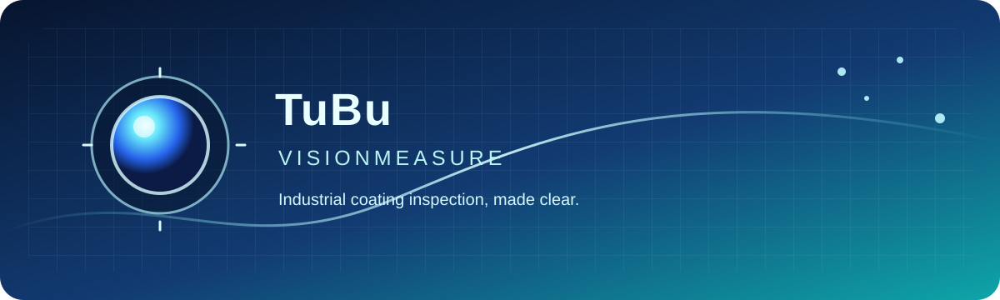

<div align="center">
  

  <p><strong>Industrial coating inspection, made clear.</strong></p>

  <p>
    <a href="README.zh-CN.md">简体中文</a> ·
    <a href="https://vchenhev.github.io/tubu/">Online manual</a> ·
    <a href="https://github.com/vchenhev/tubu/releases/latest">Latest release</a> ·
    <a href="CHANGELOG.md">Release history</a>
  </p>

  <p>
    <a href="https://github.com/vchenhev/tubu/actions/workflows/release.yml"></a>
    <a href="https://vchenhev.github.io/tubu/"></a>
    <a href="CHANGELOG.md"></a>
  </p>
</div>

## What is TuBu?

TuBu VisionMeasure is an industrial vision platform for continuous coating inspection. It brings camera acquisition, measurement, defect review, process feedback and production records into one focused workspace.

The public release repository provides the software entry points that matter to users: the latest installer, the online manual and a clear record of product changes.

## Built for the production line

| Capability | What it helps with |
| --- | --- |
| **Live inspection** | Monitor coating quality with camera-based measurement and defect classification. |
| **Recipe-driven setup** | Keep products, regions, calibration and inspection parameters organized. |
| **Operational clarity** | Use the manual to move from a screen, parameter or alarm to an actionable next step. |
| **Release continuity** | Follow stable releases, verified packages and a monthly change history. |

## Start here

| Need | Link |
| --- | --- |
| Learn the workflow | [Open the online manual](https://vchenhev.github.io/tubu/) |
| Install or update | [Download the latest release](https://github.com/vchenhev/tubu/releases/latest) |
| Review what changed | [Browse the monthly release history](CHANGELOG.md) |
| Ask a question | Use the software vocabulary from the manual when describing a page, tab, parameter or alarm. |

## A calm release experience

The release pipeline turns the current production software into a versioned package, publishes the matching manual to GitHub Pages, and keeps the knowledge synchronization tasks independent from the installer. The repository stays intentionally small: the application source remains in its source repository, while this project is the public release surface.

<details>
<summary><strong>For maintainers</strong></summary>

The repository contains three focused GitHub Actions workflows:

- `release.yml` builds and publishes a package when the source branch changes.
- `daily-knowledge-sync.yml` synchronizes committed manual and QA material to the DingTalk knowledge base.
- `weekly-dingtalk-upload.yml` uploads the latest package to the configured DingTalk Drive folder.

The `docs/` directory is the GitHub Pages deployment target. Monthly release notes live in `changelog/YYYY-MM.md`; the root `CHANGELOG.md` is the index. Credentials belong in GitHub Actions Secrets and are never part of the repository content.

</details>

## Repository map

```text
README.md              Product landing page (English)
README.zh-CN.md        产品介绍页（简体中文）
CHANGELOG.md           Monthly release index
changelog/YYYY-MM.md   Monthly release notes
docs/                  GitHub Pages deployment
Tools/                 Knowledge sync and package upload tasks
.github/workflows/     Release automation
```

TuBu is designed for teams that want a dependable inspection workflow, a readable manual and a release page they can return to.
